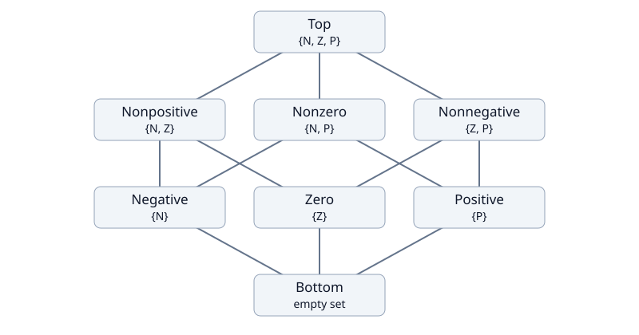

# Assignment 04: Data-flow Analysis

## Description

Write a data-flow analysis tool which uses the worklist algorithm and swappable flow functions to perform various data-flow analyses on <span style="font-variant-caps: small-caps;">While3Addr</span> programs. Your analysis tool should support a command-line interface that allows a user to specify which data-flow analysis to perform and the path to a <span style="font-variant-caps: small-caps;">While3Addr</span> source file to analyze. The analysis tool should output the results of the analysis for all variables at each program point.

### <span style="font-variant-caps: small-caps;">While3Addr</span>

You will need to write a parser for <span style="font-variant-caps: small-caps;">While3Addr</span> programs. The grammar for the <span style="font-variant-caps: small-caps;">While3Addr</span> language is provided below for reference:

$$
\begin{align*}
I &::=  &x := n \\
  &|    &x := y \\
  &|    &x := y\:op\:z \\
  &|    &\text{goto}\: n \\
  &|    &\text{if}\:x \:op_r\: 0 \:\text{goto}\: n \\
  &|    &\text{halt}
\end{align*}
$$

$$
\begin{align*}
&op ::=  \:&+ | - | * |\; / \\
&op_r ::= \:&< | =\\
&P \in &\mathbb{N} \rightarrow I
\end{align*}
$$

The programs are provided in text source files and the line numbers of the file are used by the goto- and if-statements. Because the language syntax does not exhibit nested structure, a handwritten parser to recognize the six forms of instructions can be quickly written and will suffice for this project. You are welcome to implement the parser however you prefer.

### Arithmetic

Treat variables and integer literals as unbounded signed integers; you do not need to model overflow or underflow. Integer division truncates toward zero (for example, `-3 / 2` is `-1`). In sign analysis, if the divisor is $Z$, report a definite division-by-zero warning. If its sign includes zero together with other values ($\mathrm{Nonpositive}$, $\mathrm{Nonnegative}$, or $\top$), report a possible division-by-zero warning. In either case, use $\top$ for the destination. Report warnings using the final IN states of reachable division instructions. Continue the analysis; you do not need to model exceptions.

### Analyses

You will implement two data-flow analyses: *integer sign analysis* and *reaching definitions analysis*. These analyses should be implemented as flow functions which are provided to your implementation of the worklist algorithm. It should be possible to extend your program analysis framework with new flow functions, although only the two flow functions mentioned here are required for this assignment. Both analyses must conservatively include every possible result under the rules below and iterate to a fixed point. You do not need to compute exact concrete values or distinguish every feasible execution path.

#### Integer Sign Analysis

In integer sign analysis, track sets of possible signs. Use the eight-element domain $L=\mathcal{P}(\{N,Z,P\})$, where $N$ means negative, $Z$ means zero, and $P$ means positive:

Abstract value | Set of signs | Meaning
--- | --- | ---
$\bot$ | $\emptyset$ | No possible value
$N$ | $\{N\}$ | Negative
$Z$ | $\{Z\}$ | Zero
$P$ | $\{P\}$ | Positive
$\mathrm{Nonpositive}$ | $\{N,Z\}$ | Zero or negative
$\mathrm{Nonnegative}$ | $\{Z,P\}$ | Zero or positive
$\mathrm{Nonzero}$ | $\{N,P\}$ | Negative or positive
$\top$ | $\{N,Z,P\}$ | Any integer



The precision order is set inclusion. **Join** ($\sqcup$) is set union; **meet** ($\sqcap$) is set intersection. For example, $N\sqcup Z=\mathrm{Nonpositive}$ and $\mathrm{Nonzero}\sqcap\mathrm{Nonnegative}=P$. Join states variable by variable when merging incoming paths.

Constants must receive their known sign, copies must preserve the source sign, and assignments must replace the destination's previous sign. For addition, subtraction, multiplication, and division by a known nonzero divisor, use the most specific value in this domain that includes all results allowed by the operand signs. For example, positive plus positive is $P$, positive plus negative is $\top$, and positive divided by positive is $\mathrm{Nonnegative}$ because the integer quotient may be zero or positive. You may treat operands independently; recognizing relationships such as `x - x` is optional.

For each conditional edge, refine the tested variable by taking the **meet of its current value with the edge's constraint**:

Condition | True-edge constraint | False-edge constraint
--- | --- | ---
`x < 0` | $N$ | $\mathrm{Nonnegative}$
`x = 0` | $Z$ | $\mathrm{Nonzero}$

All other variables keep their current values. If the meet is $\bot$, the entire edge state is unreachable: contribute no information and do not schedule the successor because of that edge. Otherwise, join the refined state into the successor's IN state and schedule the successor if its IN state changes. The CFG itself is unchanged. For example, if $x=\mathrm{Nonzero}$, the false edge of `x < 0` refines it to $P$; if $x=N$, that edge produces $\bot$. This requirement applies to integer sign analysis.

#### Reaching Definitions Analysis

A reaching definitions analysis determines which assignments of a variable may be active at each program point. For example, in the [`prog_4.w3a`](#prog_4) program the assignment to variable `y` at either instruction 3 or instruction 7 may reach the use of `y` in instruction 6: `z := z * y`. We will use subscripts to indicate the line number where a variable assignment occurs. In the earlier example, we would use $y_3$ and $y_7$ to respectively denote the assignments to `y` at instruction 3 and instruction 7.

Like the sign domain, reaching definitions uses a powerset lattice. Let $\mathrm{Defs}$ be the set of all assignments in the program, each identified by its variable and instruction number. Analysis values are subsets of $\mathrm{Defs}$, ordered by inclusion: $A\sqsubseteq B$ exactly when $A\subseteq B$. Smaller sets are more precise because they admit fewer possible sources of a variable's value. Join (least upper bound) is union; meet (greatest lower bound) is intersection. The least element is $\emptyset$, and the greatest is $\mathrm{Defs}$. An empty definition set is distinct from an unreachable state.

An assignment to `x` removes all incoming definitions of `x` and adds the definition at the current instruction. Other variables' definitions remain unchanged. At a join, take the union of the incoming definition sets. Reaching definitions uses both conditional edges without sign-based filtering; the branch-refinement requirement above applies to sign analysis.

##### Worked Example

The subscripts label assignment sites, not new program variables. Consider:

```text
1: x := 1
2: if c = 0 goto 5
3: x := 2
4: goto 6
5: x := 3
6: y := x
7: halt
```

The final reaching-definition results are:

Instruction | IN | OUT
--- | --- | ---
1 | $\emptyset$ | $\{x_1\}$
2 | $\{x_1\}$ | $\{x_1\}$
3 | $\{x_1\}$ | $\{x_3\}$
4 | $\{x_3\}$ | $\{x_3\}$
5 | $\{x_1\}$ | $\{x_5\}$
6 | $\{x_3,x_5\}$ | $\{x_3,x_5,y_6\}$
7 | $\{x_3,x_5,y_6\}$ | $\{x_3,x_5,y_6\}$

Either $x_3$ or $x_5$ may supply the value of `x` used at line 6. The original definition $x_1$ cannot reach that use because both paths overwrite `x`. At the merge, join combines the two incoming sets by union.

The copy `y := x` generates $y_6$, identifying where `y` is assigned; it does not copy the definition labels of `x` onto `y`. Likewise, an assignment inside a loop retains the same definition label each time it executes: labels identify instructions, not execution counts.

### Initialization

Execution begins at the first instruction (instruction 1). Its IN state describes the allowed initial conditions:

Analysis | Entry state | Reason
--- | --- | ---
Integer sign | Every variable maps to $\top$ | Initial values may be any integer.
Reaching definitions | $\emptyset$ | No program assignments have executed yet.

Initially, only the first instruction (instruction 1) has reachable input. Mark the other IN states and all OUT states as `unreachable` until reachable information arrives. This is a starting value, not a conclusion that those instructions can never execute. A predecessor's reachable output can update a successor's IN state and make it reachable. An input that is still `unreachable` produces an `unreachable` output; an unreachable contribution adds no information at a join. Keep this marker distinct from an unknown sign or an empty reaching-definitions set.

Initially schedule the first instruction. After processing an instruction, propagate its output along its outgoing edges, applying branch refinement for sign analysis. Join each contribution into the successor's IN state and schedule the successor if that state changes. This propagates reachable information from the entry through the program.

If a back edge targets instruction 1, join its contribution with the original entry state. Revisit instructions as their inputs change until the worklist is empty and the analysis has reached a fixed point.

### Tool Usage

Your data-flow analysis tool should provide a command-line interface where both the analysis to perform and the path to the program source file are provided as arguments. After reaching a fixed point, output a final table with one row per instruction and columns for its instruction number, **IN** state (before the instruction), and **OUT** state (after the instruction). Include the sign of every variable for sign analysis or the set of reaching definitions for reaching definitions analysis. Explicitly mark unreachable instructions. Conditional-edge refinement is applied when propagating the conditional's OUT state to each successor's IN state.

For both analyses, the output must also include a worklist trace table with columns for the instruction processed, its current IN state, its current OUT state, and the **worklist** after propagation at each step. List the instruction numbers still pending in the worklist, or `empty` when none remain. Include every processing step, even when an instruction is processed more than once. Keep this trace separate from the final results table. Processing order may differ between implementations; the final results must satisfy the analysis rules. See the [Program Analysis](https://cmu-program-analysis.github.io/2024/resources/program-analysis.pdf) book on pages 29 and 30 for examples of tracing an analysis.

Here is example output for analyzing the following simple program:
```
1: x := 1
2: y := -1
3: halt
```

``` console
$ tool signed path/to/prog.w3a

Final results:
instr | IN         | OUT
1     | x->T y->T  | x->P y->T
2     | x->P y->T  | x->P y->N
3     | x->P y->N  | x->P y->N

Worklist trace:
instr | IN        | OUT       | worklist
1     | x->T y->T | x->P y->T | 2
2     | x->P y->T | x->P y->N | 3
3     | x->P y->N | x->P y->N | empty
```

``` console
$ tool reaching path/to/prog.w3a

Final results:
instr | IN      | OUT
1     | empty   | x_1
2     | x_1     | x_1 y_2
3     | x_1 y_2 | x_1 y_2

Worklist trace:
instr | IN      | OUT     | worklist
1     | empty   | x_1     | 2
2     | x_1     | x_1 y_2 | 3
3     | x_1 y_2 | x_1 y_2 | empty
```

Here `T` denotes $\top$. The traces show one possible processing order, scheduling each successor when its input first receives information.

### Clarifying Points
- <span style="font-variant-caps: small-caps;">While3Addr</span> source code should include explicit line numbers and those line numbers should correspond to the actual line number. This requirement is intended to preserve a reader's sanity.
- The `halt` instruction indicates the program should stop executing and otherwise has no semantic significance.

## Example Programs

### prog_1.w3a
```
1: x := 1
2: y := 1
3: x := x - y
4: halt
```

### prog_2.w3a
```
1: x := 0
2: if x < 0 goto 5
3: x := 1
4: goto 2
5: halt
```

### prog_3.w3a
```
1: t := 1
2: x := 10
3: y := 0
4: if x = 0 goto 8
5: y := 1
6: x := x - t
7: goto 4
8: x := y
9: halt
```

### <a name="prog_4"></a>prog_4.w3a
```
1: t := 1
2: u := -1
3: y := x
4: z := 1
5: if y = 0 goto 9
6: z := z * y
7: y := y - t
8: goto 5
9: x := u
10: z := y / x
11: halt
```
## Submissions

Please provide the source code for your data-flow analysis tool, a report describing your project and instructions on how to run it, and your analysis tool's output showing the results for the provided <span style="font-variant-caps: small-caps;">While3Addr</span> example programs.

Your tool should produce correct results for all <span style="font-variant-caps: small-caps;">While3Addr</span> programs.

## Peer Review

Each student must evaluate every other member of their team.

Criterion | What to consider | Strong | Mixed | Weak
--- | --- | --- | --- | ---
Contribution | Completed a fair share of meaningful work, including implementation, testing, documentation, or analysis. | 4 | 2 | 0
Reliability | Followed through on commitments and communicated progress or problems promptly. | 3 | 2 | 0
Collaboration | Helped teammates, participated in decisions, and responded constructively to feedback. | 3 | 2 | 0

Use this scale for each criterion:

- **Strong:** Consistently did their part in this area; full credit.
- **Mixed:** Contributed in this area, but with meaningful gaps or inconsistencies; half credit, rounded up to the next whole point.
- **Weak:** Made little or no contribution in this area; no credit.

Add the three criterion scores for a total out of **10 points** per teammate.

For each teammate, provide their name, a Strong/Mixed/Weak rating and point score for each criterion, the total out of 10, and one or two sentences explaining the ratings with concrete examples.

Submit **one document individually to Canvas by the assignment deadline**, containing your evaluations of all other team members. Do not include these evaluations in the group report or submit them as a group.

## Grading

The assignment will be graded based on:

- (40%) A data-flow analysis framework implementation using the worklist algorithm and implementations for integer sign analysis and reaching definition analysis on <span style="font-variant-caps: small-caps;">While3Addr</span> programs.
- (10%) A written guide (two or more pages) for your implementation containing an overview of its architecture, user documentation stating how to setup the tool and run analyses, and team-member attribution stating which team members worked on which components of the tool.
- (10%) Logs (separate files or included in report) containing the final IN/OUT tables and worklist traces for both analyses on all provided example programs, including any division-by-zero warnings from sign analysis.
- (10%) Individual contribution and teamwork, informed by peer reviews.
- (30%) Demonstration of understanding your data-flow analysis tool's architecture and implementation. Each team member should be prepared to explain the worklist algorithm, initialization, joins, and the flow functions for both analyses.
